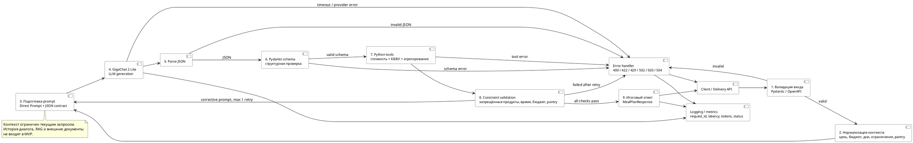

# AI Pipeline — «Планировщик питания»

## 1. Назначение

AI-компонент получает структурированные предпочтения пользователя и формирует черновик плана питания. LLM используется для смысловой генерации меню, а точные расчёты и проверки выполняются программно.

Подход MVP: **Direct Prompt + Structured JSON + Python tools**. RAG и полноценный автономный агент в MVP не используются.

Ключевое ограничение: пользовательский запрос должен укладываться в **30 секунд**. По результатам Lab 1 средняя задержка GigaChat 2 Lite составила 3,88 с, а все 9 сопоставимых запусков были не более 30 с.

## 2. Схема обработки

## 3. Этапы и контракты

| Этап | Вход | Выход | Основные проверки |
|---|---|---|---|
| Валидация входа | HTTP JSON | `MealPlanRequest` | обязательные поля, типы, диапазоны |
| Нормализация | `MealPlanRequest` | нормализованный контекст | единицы измерения, пустые значения |
| Prompt | контекст + системные правила | сообщения LLM | лимит input context |
| LLM | prompt | текст | timeout, provider status, `finish_reason` |
| JSON parsing | текст | JSON object | синтаксическая корректность |
| Schema validation | JSON | `GeneratedMealPlan` | Pydantic, обязательные поля |
| Tools | структурированный план + каталоги | стоимость, КБЖУ, покупки | отсутствие неизвестных продуктов |
| Constraint validation | все рассчитанные данные | validation report | бюджет, ограничения, время, pantry |
| Final response | validated plan | `MealPlanResponse` | отсутствие внутренних данных |

## 4. Входные данные

Минимальный MVP-контракт:

- `goal` — цель питания;
- `budget.amount` и `budget.currency` — бюджет;
- `days` — число дней;
- `restrictions` — ограничения/диетические требования;
- `excluded_products` — явно запрещённые продукты;
- `pantry` — продукты дома и их количество;
- `max_cook_time_min` — максимальное время приготовления блюда.

Требование к входу: API не принимает произвольную историю чата как скрытый контекст. Всё, что необходимо модели, должно быть представлено в структурированном запросе.

## 5. Подготовка prompt

System prompt содержит только правила MVP и JSON-контракт. Пользовательские данные подставляются как структурированные значения.

Модель отвечает за:

- интерпретацию цели;
- подбор блюд;
- комбинирование ингредиентов;
- использование pantry;
- формирование структурированного черновика.

Модель **не является источником истины** для:

- точной стоимости;
- точного КБЖУ;
- итоговой суммы покупок;
- прохождения формальных ограничений.

## 6. Structured JSON и проверки

После ответа выполняются две разные проверки:

1. **JSON validity** — ответ можно разобрать как JSON.
2. **Schema validity** — JSON соответствует Pydantic-схеме.

Если модель вернула Markdown, поясняющий текст или оборванный JSON, результат не считается готовым ответом.

Отдельно проверяется `finish_reason`. Значение `length` считается потенциально неполным ответом и требует повторной генерации/сокращения.

## 7. Программные инструменты

MVP использует Python-инструменты:

- `calculate_cost()` — расчёт стоимости по каталогу цен;
- `calculate_nutrition()` — расчёт КБЖУ по базе продуктов;
- `aggregate_ingredients()` — объединение одинаковых ингредиентов;
- `validate_constraints()` — формальная проверка ограничений;
- генератор списка покупок — разница между требуемым количеством и pantry.

Источником точных цен и пищевой ценности в production должна быть отдельная база/сервис. Демонстрационный `PRICE_DB` из Lab 1 не является production-источником.

## 8. Проверки ограничений

Проверяется минимум:

- запрещённые продукты отсутствуют;
- `cook_time_min <= max_cook_time_min`;
- рассчитанная стоимость не превышает бюджет, если бюджет задан как жёсткое ограничение;
- продукты pantry учитываются в агрегировании;
- количества ингредиентов неотрицательны;
- структура плана полна.

Если constraint validation не пройдена, архитектурой предусмотрен **не более одного** корректирующего вызова модели. Корректирующий prompt должен содержать только конкретные нарушения и исходный структурированный план, без повторного добавления всей нерелевантной истории. В spike Lab 2 первичный ответ прошёл проверки, поэтому corrective retry не выполнялся (`not_needed`); эффективность этого механизма пока экспериментально не подтверждена.

Если после retry ограничения всё ещё нарушены, API возвращает контролируемую ошибку, а не неподтверждённый план.

## 9. Границы контекста

В MVP в LLM передаются:

- system prompt;
- текущий пользовательский запрос;
- при retry — конкретные ошибки валидации и исправляемый план.

Не передаются автоматически:

- предыдущие диалоги;
- документы пользователя;
- веб-страницы;
- неструктурированные данные из других сервисов.

Целевой бюджет контекста из Lab 1: до 1500 input tokens и до 1400 output tokens на основной вызов. Это ориентир, а не гарантия провайдера.

## 10. Логирование

Для каждого запроса рекомендуется сохранять:

- `request_id`;
- timestamp;
- модель/версию;
- latency;
- input/output/total tokens, если провайдер их предоставляет;
- статус этапа;
- тип ошибки;
- факт retry;
- итоговый validation status.

Не следует логировать credentials, access tokens и лишние персональные данные. Сырый ответ LLM не должен попадать в production-логи без отдельного обоснования.

## 11. Обработка ошибок

| Ситуация | Реакция |
|---|---|
| Некорректный HTTP JSON | `400 Bad Request` |
| Ошибка входной схемы | `422 Unprocessable Entity` |
| Rate limit провайдера | `429 Too Many Requests` |
| Timeout модели | `504 Gateway Timeout` |
| Ошибка внешнего AI-провайдера | `502 Bad Gateway` |
| Временная недоступность AI | `503 Service Unavailable` |
| Невалидный JSON от LLM | retry → ошибка сервиса |
| Невалидная Pydantic-схема | retry → ошибка сервиса |
| Нарушение ограничений | retry → ошибка сервиса |
| Ошибка каталога цен/КБЖУ | `503 Service Unavailable` |

## 12. Граница ответственности AI Engineer / Delivery

AI Engineer отвечает за prompt, модельный адаптер, parsing, schema validation, tools и constraint validation.

Delivery отвечает за HTTP API, аутентификацию/авторизацию при необходимости, маршрутизацию, correlation/request ID, transport-level errors и публикацию OpenAPI-контракта.

Общий контракт должен оставаться независимым от конкретного SDK GigaChat.

## 13. Связь с командными артефактами

AI pipeline должен быть представлен в C4 Container как часть AI/Meal Planning backend или отдельный AI-компонент, в зависимости от принятого командой разбиения контейнеров.

Use Cases, связанные с AI:

- задать параметры питания;
- сгенерировать план питания;
- получить список покупок;
- увидеть стоимость и КБЖУ.

ERD должен хранить пользовательские параметры/план только на уровне, согласованном с общей моделью данных. AI-компонент не вводит собственную отдельную БД в MVP.

Golden dataset используется для evals и должен покрывать те же ограничения, которые проверяются в pipeline.

Threat model должен учитывать prompt injection через пользовательские поля, утечку секретов в логи, злоупотребление API и недоверие к модельному output.
